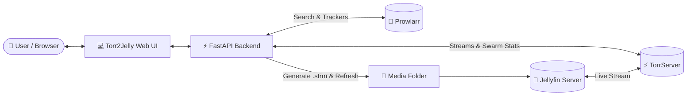

# Torr2Jelly 🚀🍿

<p align="center">
  
</p>

<p align="center">
  <strong>Stream Torrents on Jellyfin in Seconds without Waiting for Downloads</strong>
</p>

<p align="center">
  <a href="https://github.com/D1st3f-PRJCTS/torr2jelly/actions/workflows/docker-publish.yml"></a>
  <a href="https://github.com/D1st3f-PRJCTS/torr2jelly/pkgs/container/torr2jelly"></a>
  
  
  
</p>

---

## 🌟 Overview

**Torr2Jelly** is a modern, lightweight bridge connecting **Prowlarr**, **TorrServer**, and **Jellyfin**. It allows users to search trackers, add torrents with one click, automatically generate `.strm` links, organize media hierarchies, and start streaming high-bitrate movies and shows directly on Jellyfin within seconds.



---

## ✨ Key Features

- 🔍 **Unified Prowlarr Search**: Instant tracker search with automatic seeders/peers sorting and category matching.
- 🥇 **Freeleech & Gold Torrent Filtering**: Built-in toggle to restrict regular users to gold/freeleech torrents while admins retain full access.
- ⚡ **Instant Streaming via TorrServer**: No waiting hours for multi-gigabyte downloads. Playback starts immediately as TorrServer caches the stream on disk or RAM.
- 🍿 **Automated `.strm` Generation**: Intelligently detects movies vs. multi-episode series and writes clean, standardized `.strm` files into target Jellyfin libraries.
- 📊 **Realtime Swarm & Speed Dashboard**: Live seeder/leecher counters, peer connection monitors, and realtime download/upload throughput gauges for active streams.
- 🗂️ **Smart Season Auto-Organizer**: 1-click organizer that analyzes episode file naming conventions (`S01E02`, `1x05`, etc.) and arranges them into standard season directories.
- 👥 **Multi-User RBAC & Security**: Role-based access control (Admin / Regular User), salted SHA-256 passwords, JWT bearer tokens, and user management modal.
- 🌐 **Modern Glassmorphic UI**: Beautiful dark interface with Ukrainian and English language localization.

---

## ⚡ Quickstart with Docker Compose

Running Torr2Jelly is as simple as adding this short service to your `docker-compose.yml`:

```yaml
services:
  torr2jelly:
    image: ghcr.io/d1st3f-prjcts/torr2jelly:latest
    container_name: torr2jelly
    restart: unless-stopped
    ports:
      - "8095:8095"
    environment:
      - TORRSERVER_URL=http://torrserver:8090
      - JELLYFIN_STREAM_TORR_URL=http://torrserver:8090
      - JELLYFIN_URL=http://jellyfin:8096
      - JELLYFIN_API_KEY=your_jellyfin_api_key
      - PROWLARR_URL=http://prowlarr:9696
      - PROWLARR_API_KEY=your_prowlarr_api_key
      - MEDIA_DIR=/media
    volumes:
      - /path/to/media:/media
      - /path/to/config:/app/config
    networks:
      - media-net

networks:
  media-net:
    name: media-net
    external: true
```

Start the container:
```bash
docker compose up -d
```

Open your browser at **`http://<server-ip>:8095`** to complete the initial admin setup and start streaming!

---

## ⚙️ Configuration Reference

All settings can be configured either through the **Settings UI** (saved persistently in `config/settings.json`) or via **environment variables**:

| Environment Variable | Default | Description |
|---|---|---|
| `PORT_BINDING` | `8095` | Host port to expose the web interface. |
| `TORRSERVER_URL` | `http://torrserver:8090` | Internal URL used by Torr2Jelly backend to communicate with TorrServer. |
| `JELLYFIN_STREAM_TORR_URL` | `http://torrserver:8090` | URL written into `.strm` files accessible by Jellyfin to stream video. |
| `JELLYFIN_URL` | `http://jellyfin:8096` | Jellyfin server URL for library refreshes. |
| `JELLYFIN_API_KEY` | `""` | Jellyfin API Key (Admin Dashboard -> API Keys). |
| `PROWLARR_URL` | `http://prowlarr:9696` | Prowlarr URL for searching torrent indexers. |
| `PROWLARR_API_KEY` | `""` | Prowlarr API Key (Settings -> General -> Security). |
| `MEDIA_DIR` | `/media` | Target root directory where `.strm` files are written. |
| `AUTO_SYNC` | `true` | Periodically scans TorrServer and refreshes library. |
| `SYNC_INTERVAL` | `30` | Interval in seconds between auto-sync checks. |
| `ONLY_GOLD_TORRENTS` | `false` | When enabled, non-admin users only see gold/freeleech torrents in search results. |
| `JWT_SECRET` | Auto-generated | Secret key used to sign JWT authentication tokens. |

---

## 🛠️ Development & Testing

Run unit and integration tests:
```bash
# Install dependencies
pip install -r requirements.txt

# Run pytest suite
pytest
```

Format and lint Python code (PEP 8):
```bash
ruff check backend tests
ruff format backend tests
```

---

## 📜 License

Distributed under the **MIT License**. See `LICENSE` for more information.
